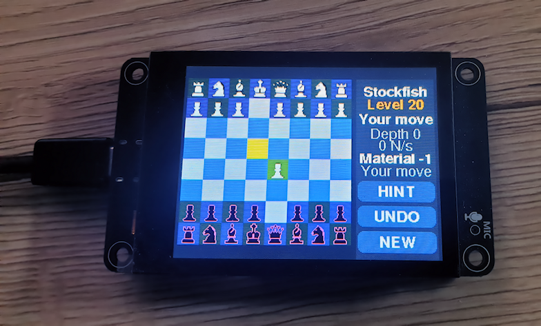

# Stockfish ESP32-S3

A touchscreen chess computer powered by **Stockfish 19 Smallnet**, built for the Freenove ESP32-S3 Display board.

The project combines a complete chess game interface with the Stockfish engine on a compact ESP32-S3 device. It is an experimental hardware project and is currently tailored to one specific display board.



## Features

- Play against Stockfish on the integrated touchscreen.
- Choose to play as White or Black.
- Adjust the engine strength from Level 1 to Level 20.
- Enable or disable the optional Polyglot opening book in the new-game menu.
- Legal destination squares are highlighted when selecting a piece.
- Pawn promotion is handled with an on-screen piece selector.
- Undo the previous move, request a hint, or start a new game.
- The board automatically rotates when you play as Black.
- Detects check, checkmate, stalemate, the 50-move rule, threefold repetition and supported insufficient-material draws.
- Touchscreen calibration is performed on first start and stored in flash.
- The current game, player colour and game strength are saved automatically and restored after a reboot. The opening-book enable/disable preference is stored separately in NVS.

## Hardware

The firmware is designed for this board configuration:

| Component | Configuration |
|---|---|
| Board | Freenove ESP32-S3 Display, FNK0104B |
| Display | 2.8-inch ILI9341, 320 × 240 pixels |
| Touch controller | FT6336U capacitive touch |
| Processor | ESP32-S3, dual-core Xtensa LX7 |
| PSRAM | 8 MiB OPI |
| Flash | 16 MiB |

**Compatibility note:** This is not a generic ESP32-S3 firmware. Display, touch, flash and PSRAM settings are specific to the Freenove board above. Other ESP32-S3 boards and display variants have not been validated.

## Playing

### First start

On the first boot, the display starts a three-point touch calibration. Tap each crosshair when prompted. The calibration is stored in flash and is reused after reboot.

### Start a game

1. Open **New Game**.
2. Choose **White** or **Black**.
3. Enable or disable **Opening book** as required.
4. Set the Stockfish level with the minus and plus controls.
5. Tap **Start**.

### Make moves

Tap one of your pieces, then tap a highlighted destination square. If a pawn reaches the last rank, choose the promotion piece in the dialog.

The side panel provides the **HINT**, **UNDO** and **NEW** controls. The HINT button asks Stockfish for a suggested move. UNDO takes back the previous move pair where possible. NEW returns to the new-game screen.

### Saved games

The current position and move history are saved automatically after accepted moves and game changes. After a restart, the previous game can be restored. The saved game retains its original player colour and Stockfish level; the menu selection for the next game is stored separately.

## USB serial console

Connect the board to a computer and open a serial monitor at **115200 baud**. The console accepts commands for testing and game control:

| Command | Description |
|---|---|
| `help` | Show available commands |
| `print` | Print the current board in Stockfish ASCII format |
| `moves` or `uci` | Print the current move sequence / UCI position |
| `fen` | Print the current FEN |
| `undo` | Undo the previous move |
| `hint` | Ask Stockfish for a suggested move |
| `calibration` | Start touch calibration again |
| `level 1..20` | Set the strength for the next game |
| `book` | Show whether the opening book is enabled |
| `book on` / `book off` | Enable or disable opening-book use |
| `pgn` / `pgn export` | Export the current game in PGN/SAN format |
| `pgn import` | Start a multi-line PGN import (auto-finishes at result marker) |
| `newgame [level] [white\|black]` | Start a new game |
| `position startpos [moves ...]` | Load a start position and optional moves (streamed) |
| `position fen <FEN> [moves ...]` | Load a FEN position and optional moves (streamed) |

Long `position` and `fen` commands are received token by token; the complete command line is not stored in the 2048-byte serial line buffer. Moves are appended directly to the compact 16-bit move history (maximum 4096 plies), with the normal Stockfish position validation performed after the line ends.

A single move can also be entered directly in UCI notation, for example `e2e4` or `e7e8q` for a promotion. The current board is printed automatically after importing a position with `position`, `fen` or `pgn import`; use `print` to display it again. Short castling can be entered as `O-O`, `o-o` or `0-0`; it is converted to the normal UCI move for the side to move.

To import a game, enter `pgn import` and paste the complete PGN (including optional tag pairs and SAN movetext). Import starts automatically when the movetext reaches a result marker (`1-0`, `0-1`, `1/2-1/2` or `*`). `ENDPGN` can be used as a manual finish for PGNs without a result marker; send `CANCELPGN` to abort. The importer validates every SAN move against Stockfish's legal-move list before replacing the current game. Comments, numeric annotations and parenthesized variations are ignored.

## Build and upload

The repository contains the firmware source and PlatformIO configuration. Install PlatformIO Core and run the following commands from the repository root:

```sh
# Compile the touchscreen application
pio run -e freenove_stockfish_gui

# Upload it to the connected Freenove board
pio run -e freenove_stockfish_gui -t upload

# Run the host-side chess/GUI regression tests (Linux or WSL)
bash tests/native/run_tests.sh
```

The serial console uses 115200 baud. PlatformIO installs the Espressif32 toolchain and libraries required by the selected environment. The Stockfish build script downloads the required Smallnet NNUE network during the build, so the first build needs Internet access.

GitHub Actions runs the native regression suite and the firmware build matrix for relevant changes on `main` and pull requests targeting `main`. A separate Gitleaks workflow checks the repository files and the full reachable Git history across branches on every branch push and weekly.

## Opening book

The firmware can use a Polyglot opening book stored in a separate, read-only flash partition. The book is checked when the firmware starts; if no legal book move is available, Stockfish searches normally. Opening-book use can be toggled in the **New Game** menu or with the serial commands `book on` and `book off`. The setting is stored in NVS and remains in effect after reboot. The book defaults to enabled on installations without a saved setting.

The book image is prepared and flashed separately. See [Flashing an opening book](docs/FLASHING-OPENING-BOOK.md) for the image format and procedure.

## Project status

The touchscreen application, Stockfish engine and optional Polyglot opening book are running on the target board. This remains an experimental project rather than a general-purpose, production-ready chess product. The firmware is tailored to the FNK0104B; the opening-book image is flashed separately from the application.

For implementation details, benchmark results, build environments, NNUE/PIE validation and development history, see the [extended technical README](README-extended.md).

## Source and licence

This project, including the integrated Stockfish-derived firmware, is distributed under the **GNU General Public License version 3 (GPLv3)**. The complete license is in the repository-root [LICENSE](LICENSE) file; the original Stockfish license copy, author list and copyright notices remain under [src/stockfish](src/stockfish/).

The engine is based on [official Stockfish](https://github.com/official-stockfish/Stockfish). Third-party components and artwork retain their respective copyright and license notices. When distributing firmware, comply with GPLv3 requirements for the corresponding source code and build modifications.
